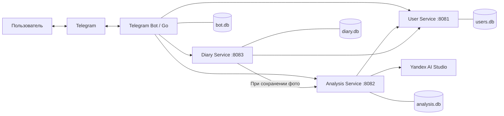

# Food Diary — MVP на Go

Telegram-бот для дневника питания с анализом фотографий через Yandex AI Studio.
Три автономных бизнес-сервиса, отдельное приложение бота, HTTP-взаимодействие и собственная SQLite-база у каждого приложения.

## Возможности

- Вход через Telegram: постоянный внутренний `user_id`, отдельная таблица `auth_identities` для будущего Google OIDC.
- До 5 анализов фотографий в день по часовому поясу профиля. Гостевого доступа нет.
- Определение блюда, ингредиентов, массы и приблизительного КБЖУ через VLM.
- Подтверждение результата перед сохранением. Редактирование названия, массы, состава, КБЖУ порции, даты и времени.
- Пересчёт порции в Go без обращения к модели. КБЖУ ингредиентов задаётся на 100 г.
- Ручное добавление еды без расхода квоты.
- CRUD записей дневника, пагинация, переход между днями, просмотр исходного анализа.
- Ручная суточная норма и остаток КБЖУ. Отрицательный остаток показывает превышение.
- Диалоги, черновики и Telegram polling offset сохраняются в базе бота.
- Сохранённые записи доступны при отключении анализа; ручной ввод не зависит от ИИ.

Автоматический расчёт нормы по цели, Google-вход, сайт, ночные отчёты и уведомления в эту версию не входят.

## Архитектура



Базы и volumes не разделяются между сервисами. Общий пакет `internal/core` содержит контракты, арифметику и HTTP-инфраструктуру; бизнес-вызовы между процессами выполняются только по HTTP. Compose DNS обеспечивает обнаружение по именам сервисов. Серверы не хранят пользовательское состояние в памяти между запросами; данные находятся в SQLite. Локальные токены подписаны HMAC-SHA256 и действуют 24 часа; бот обновляет их через 20 часов.

## Быстрый запуск на Windows

Нужны Docker Desktop с Linux containers и подключение к интернету. Установленный Go не требуется для Docker-запуска.

```powershell
cd C:\Users\Admin\Desktop\food_diary
powershell -ExecutionPolicy Bypass -File .\scripts\setup.ps1
```

Скрипт создаёт `.env` с двумя случайными секретами, существующий файл не перезаписывает.
В `.env` заполните:

```dotenv
TELEGRAM_BOT_TOKEN=токен_от_BotFather
YANDEX_API_KEY=API_ключ_Yandex_AI_Studio
```

Не публикуйте `.env`. Токен бота получите у официального `@BotFather` в Telegram. Боту нужен личный чат; групповые сообщения игнорируются. Запускайте только одну копию polling-бота на токен. Если у бота ранее был webhook, его нужно самостоятельно удалить перед использованием long polling.

```powershell
docker compose up --build -d
docker compose ps
docker compose logs -f
```

Откройте личный чат с ботом, отправьте `/start`, в настройках укажите часовой пояс (например, `Asia/Yekaterinburg`) и норму КБЖУ. Затем отправьте фото или выберите ручное добавление.

Логи пишутся в stdout/stderr контейнеров; отдельного файла логов в проекте нет. Для бота используйте `docker compose logs -f --tail 100 telegram-bot`. Ошибки Bot API содержат метод, HTTP-статус, `error_code`, `description` и `retry_after`. Ошибки обработки действий содержат `update_id` и действие. Токен бота, тексты сообщений и фотографии в эти диагностические записи не включаются.

Остановка без удаления данных:

```powershell
docker compose down
```

Данные остаются в именованных volumes. Не добавляйте `-v`, если хотите сохранить дневник.

## Yandex AI

Значения по умолчанию:

```dotenv
AI_MODE=yandex
YANDEX_BASE_URL=https://ai.api.cloud.yandex.net/v1
YANDEX_MODEL=gpt://b1gh4nec0stgefclroq9/deepseek-v4.1-flash/latest
```

Используется OpenAI-совместимый `POST /chat/completions`: текст + `image_url` с Base64 data URL. Модель возвращает JSON, сервер проверяет структуру, массу и КБЖУ и рассчитывает суммы. JPEG/PNG до 5 МБ и до 25 Мп. Фото передаются провайдеру, но не сохраняются в наших БД; сохраняются результаты анализа.

Реальная интеграция требует отдельного smoke-теста с вашим ключом и фотографией. В каталоге Yandex URI модели указан без `/latest`; если ваш endpoint отклоняет указанную версию, проверьте доступный URI в каталоге и измените `YANDEX_MODEL`. Автоматического переключения на другую модель нет. Поддержку изображений необходимо проверить именно у Yandex endpoint, а не только у исходной модели DeepSeek.

Для проверки интерфейса без платных обращений установите `AI_MODE=mock` и пересоздайте контейнеры командой `docker compose up -d`. Возвращается фиксированная курица с рисом с явной пометкой «ТЕСТОВЫЕ данные, фотография не анализировалась». Квоты и сохранение работают как обычно. Mock не включается автоматически при ошибке реального API.

Вызовы провайдера ограничены 90 секундами. Ошибка провайдера освобождает квоту; обработанная фотография без еды расходует попытку. Pending-запрос резервирует слот. Повтор с тем же `Idempotency-Key` не создаёт новый анализ. После технической ошибки отправьте фото новым сообщением. После аварийного завершения pending-резервации старше 3 минут освобождаются при следующем запросе анализа. Автоматических повторов платных AI-запросов нет.

Квота привязана к локальной календарной дате профиля. Не меняйте часовой пояс ради переноса дневного лимита: защита от такого обхода остаётся задачей следующего этапа.

## Интерфейс

Меню: Фото / Вручную / Дневник / Остаток / Норма / Настройки.

- `/start`, `/menu`, `/help` — меню; `/cancel` — сброс текущего диалога и черновика.
- Ручной ввод: название → четыре числа `ккал белки жиры углеводы` на всю порцию → подтверждение.
- Изменение массы: `номер_ингредиента граммы`, например `1 180`.
- Изменение состава: каждая строка `название;граммы;ккал;белки;жиры;углеводы`, КБЖУ на 100 г.
- Прямой ввод КБЖУ порции заменяет состав текущего черновика; исходный результат ИИ остаётся в снимке анализа после сохранения.
- Дата/время: `2026-11-16 13:30` по часовому поясу профиля. Выбор даты дневника: `2026-11-16`.
- До 10 записей на страницу. Удаление требует нажатия отдельной кнопки подтверждения.

## Сборка и тесты без Docker

Нужен Go 1.24+.

```powershell
go mod download
go test ./...
go vet ./...
go build ./cmd/...
```

Загрузите переменные из своего окружения (`go run` не читает `.env` автоматически). В трёх терминалах можно запустить `go run ./cmd/user-service`, `go run ./cmd/analysis-service`, `go run ./cmd/diary-service`; в четвёртом — `go run ./cmd/telegram-bot`. По умолчанию используются разные файлы `data/users.db`, `data/analysis.db`, `data/diary.db`, `data/bot.db` и localhost-порты 8081–8083.

Интеграционные тесты запускают настоящие HTTP-серверы и независимые SQLite-базы во временных каталогах. Проверяют сквозной сценарий, квоты под конкуренцией, возврат попыток при ошибках, идемпотентность, права доступа, копию анализа, локальную дату и деградацию при отказах. Yandex и Telegram в тестах заменяются контролируемыми ответами, оплачиваемых запросов нет.

## API для защиты лабораторной

Полное описание: `docs/API.md`. Каждый сервис имеет публичный `GET /healthz`.
Бизнес-эндпоинты требуют `Authorization: Bearer <token>`. Внутренний вход Telegram дополнительно защищён `X-Internal-Key`; его вызывает только доверенный бот.

```powershell
Invoke-RestMethod http://localhost:8081/healthz
Invoke-RestMethod http://localhost:8082/healthz
Invoke-RestMethod http://localhost:8083/healthz
```

Проверка отказа:

1. Создайте и сохраните запись по фото, затем ручную запись.
2. Выполните `docker compose stop analysis-service`.
3. Откройте дневник, отредактируйте сохранённую запись, добавьте еду вручную: операции продолжают работать.
4. Отправьте новое фото: бот сообщает о недоступности анализа.
5. Выполните `docker compose start analysis-service` и повторите фото.

При отказе User Service новые входы и анализы недоступны. У уже вошедшего пользователя бот продолжает читать дневник и добавлять ручные записи до истечения токена. Для чтения дня Diary Service использует сохранённый ботом часовой пояс, а целевую норму помечает недоступной. Это осознанный режим деградации.

## Расширение входа через Google

`users.id` — идентификатор аккаунта; Telegram ID находится только в `auth_identities(provider, subject, user_id)`. В будущем User Service реализует Google OIDC, проверяет Google `sub` и добавляет вторую привязку к существующему аккаунту после подтверждения владения обоими входами. Дневник и квоты не меняются. Объединения по username или совпавшему email сейчас нет.

## Ограничения MVP

Это учебная версия: один polling-процесс, синхронная обработка фотографий (долгий анализ временно задерживает другие сообщения), SQLite с одним соединением у каждого сервиса, без очереди задач и горизонтального масштабирования бота. Секрет HMAC общий для доверенных backend-сервисов; для production лучше асимметричная проверка токенов и полноценный lifecycle сессий. Межсервисный HTTP находится в локальной Compose-сети; внешний production-доступ требует HTTPS и отдельной настройки окружения. Норма отображается текущая, исторические версии норм пока не сохраняются. Оценка по фотографии приблизительна.

## Источники

- [Telegram Bot API](https://core.telegram.org/bots/api)
- [Yandex: доступные модели](https://aistudio.yandex.ru/ru/docs/ai-studio/concepts/generation/models)

Шаблон отчёта лабораторной: `docs/LAB_REPORT.md`.
