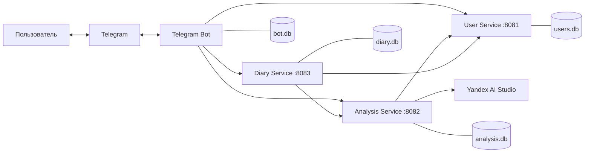
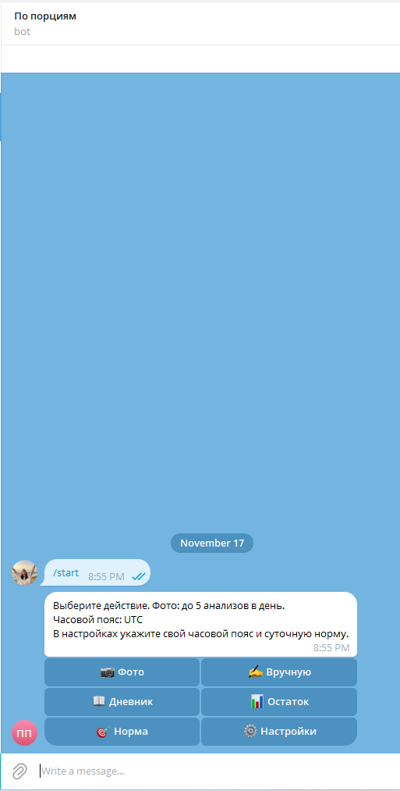
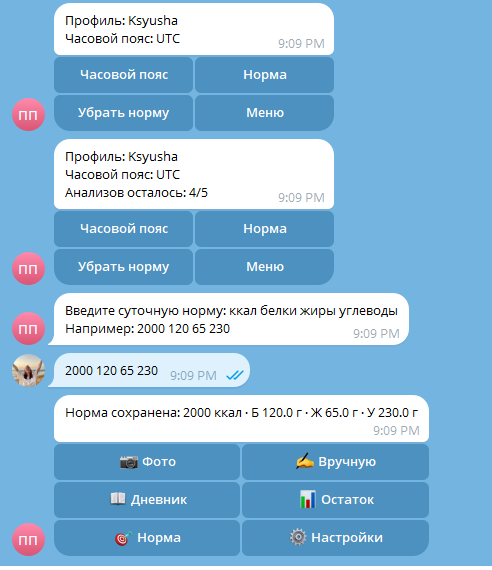
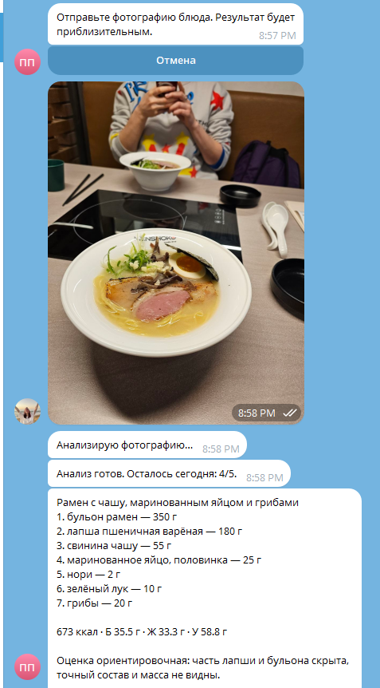
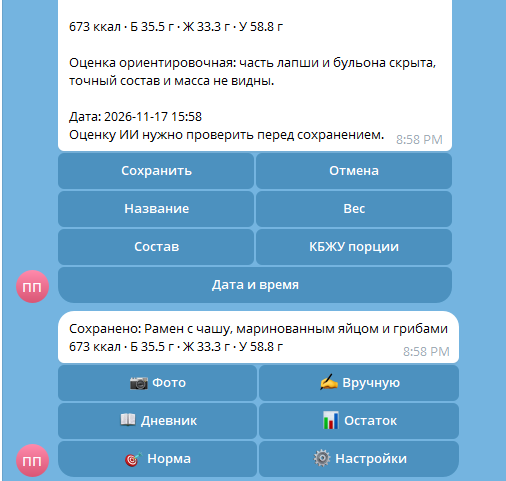
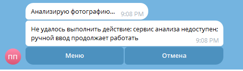
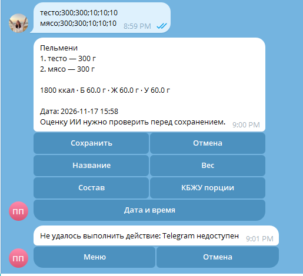

# Отчет по практической работе № 13

## Разработка микросервисного приложения с использованием сетецентрической архитектуры

**Telegram-бот:** [@portion_wise_bot](https://t.me/portion_wise_bot). Сейчас бот развернут на моей локальной машине. Если он не отвечает или недоступен, напишите мне: возможно, локальный компьютер или сервис остановлен.

**Тема проекта:** приложение «Дневник питания» с Telegram-ботом и анализом фотографий блюд.

## Цель работы

Изучить принципы проектирования и реализации программных систем на основе сетецентрической архитектуры: разделить приложение на автономные сервисы, организовать их взаимодействие только по сети, настроить отдельное хранение данных и подготовить совместный запуск контейнеров.

## Задачи

В проекте реализованы четыре отдельных процесса: User Service, Analysis Service, Diary Service и Telegram Bot. Первые три являются бизнес-сервисами; бот служит пользовательским интерфейсом. Межсервисное взаимодействие реализовано по HTTP/REST. Сервисы запускаются отдельными контейнерами Docker и настраиваются через Docker Compose.

## Архитектура приложения



**User Service** ведет профили и идентичности пользователей, а также выдает подписанные токены. **Analysis Service** принимает фотографии, проверяет пользователя, применяет дневную квоту и вызывает AI-провайдера. **Diary Service** выполняет операции над пищевыми записями и рассчитывает итоги дня. **Telegram Bot** обрабатывает команды, диалоги и черновики, обращаясь к backend-сервисам по HTTP.

У каждого процесса собственная SQLite-база в отдельном именованном Docker volume. Сервисы не читают базы друг друга и не обмениваются данными через общие файлы. Внутри Compose сервисы обнаруживаются по DNS-именам. Внутренние порты backend-сервисов — 8081, 8082 и 8083; у каждого есть `GET /healthz`.

## Реализованные возможности

- Создание и обновление пользовательского профиля, настройка часового пояса и дневной нормы КБЖУ.
- Анализ JPEG/PNG-фотографии блюда, предварительный просмотр результата и подтверждение сохранения.
- Ограничение до пяти анализов фотографий в день по часовому поясу профиля. Ручное добавление записи не расходует квоту.
- Создание, просмотр, изменение и удаление записей дневника; подсчет дневной суммы и остатка относительно заданной нормы.
- Сохранение снимка исходного анализа вместе с записью дневника.
- Защита бизнес-запросов токеном, проверка принадлежности записей пользователю, ключи идемпотентности для повторных запросов.
- Сохранение диалогового состояния и offset Telegram polling в базе бота.
- Контейнеризация всех четырех процессов и конфигурация совместного запуска через `docker-compose.yml`.

Режим `AI_MODE=mock` предусмотрен для демонстрации без внешнего AI-запроса; результат в этом режиме помечается как тестовый. Реальный анализ через Yandex AI Studio требует ключа и отдельного запуска с `AI_MODE=yandex`.

## Сетецентрические принципы

1. **Сетевое взаимодействие.** Бот обращается к API сервисов; Analysis Service и Diary Service также вызывают User Service, а дневник при сохранении записи по фотографии запрашивает Analysis Service. Вызовы между процессами выполняются по HTTP.
2. **Автономность.** У каждого процесса собственная точка запуска, Dockerfile и конфигурация. Backend-сервисы используют отдельные SQLite-базы и тома.
3. **Слабая связанность.** Сервисы обмениваются данными через API-контракты. Diary Service хранит собственный снимок результата анализа, поэтому сохраненная запись доступна без повторного запроса к AI-сервису.
4. **Stateless backend.** Данные пользователя и предметное состояние хранятся в БД; серверы не полагаются на глобальное состояние запросов в оперативной памяти.
5. **Обнаружение сервисов.** В Docker Compose клиенты используют имена сервисов и внутренние порты.

## Запуск и проверка

Для локального запуска требуются Docker Desktop с Linux containers, интернет и значения `TELEGRAM_BOT_TOKEN` и `YANDEX_API_KEY` в `.env`. Скрипт настройки создает файл с секретами, если его еще нет. После заполнения конфигурации запуск выполняется из корня проекта:

```powershell
docker compose up --build -d
docker compose ps
```

Для завершения работы без удаления сохраненных данных:

```powershell
docker compose down
```

Код содержит интеграционные тесты с HTTP-серверами и временными независимыми SQLite-базами. Среди предусмотренных сценариев — сквозной поток профиля, анализа и дневника; владение данными; параллельная квота; возврат квоты при ошибке AI-провайдера; идемпотентность; работа дневника и ручного ввода при недоступности зависимого сервиса.

Основные тесты в исходниках: `TestFullFlowAndOwnership`, `TestConcurrentQuota`, `TestFailedAnalysesRefundQuota` и `TestDiaryDuringUserOutage` в `tests/integration_test.go`; `TestTelegramErrorDescriptionAndLogs` в `internal/bot/telegram_test.go`. Это имена тестовых функций, а не подтверждение их запуска.

## Сценарии демонстрации

### Начало работы

На снимке показан ответ на `/start`, главное меню бота и подсказка о настройке часового пояса и суточной нормы.



### Настройка нормы КБЖУ

На снимке показан профиль, ввод нормы и подтверждение сохранения. В примере часовой пояс профиля — UTC.



### Анализ фотографии и сохранение блюда

Первая часть показывает отправленную фотографию и результат анализа с составом и оценкой КБЖУ. На втором снимке показано подтверждение сохранения и меню редактирования черновика.





### Недоступность Analysis Service

На снимке показано сообщение бота о недоступности сервиса анализа и указано, что ручной ввод продолжает работать.



### Недоступность Telegram при обработке действия

На снимке показана ошибка `Telegram недоступен` при действии с черновиком ручного ввода.



## Обработка отказов и ограничения

Если Analysis Service отключен, сохраненные записи и ручное добавление остаются в Diary Service доступны; новый анализ фотографии не может быть выполнен. Бот хранит в своей SQLite-базе пользовательскую сессию: профиль (в том числе имя, часовой пояс и дневную норму), токен доступа, состояние диалога и текущий черновик. Поэтому при отказе User Service уже вошедший пользователь может продолжать часть работы с сохраненной сессией, пока не потребуется обновить токен: бот пытается обновить его через 20 часов. Новая авторизация и обновление профиля в это время недоступны. Diary Service также получает часовой пояс из сохраненной сессии бота, поэтому может прочитать записи за день при недоступности User Service; целевая норма при этом помечается недоступной. Анализ фотографий требует обращения к профилю в User Service и при его отказе не выполняется. Техническая ошибка AI-провайдера освобождает зарезервированную попытку анализа. HTTP-вызовы backend выполняются с таймаутами.

## Вывод

В проекте разработано приложение дневника питания, разделенное на автономные сетевые компоненты. Реализованы отдельные процессы, HTTP API, собственные хранилища, контейнеры и совместная конфигурация Docker Compose. В коде предусмотрены квоты, проверка доступа, идемпотентность и режимы работы при отказах зависимостей. Приложенные скриншоты иллюстрируют начало работы с ботом, настройку нормы, анализ фотографии и сообщения о недоступности сервисов. Успешный запуск Compose и тестовый прогон в данном отчете не подтверждаются.
